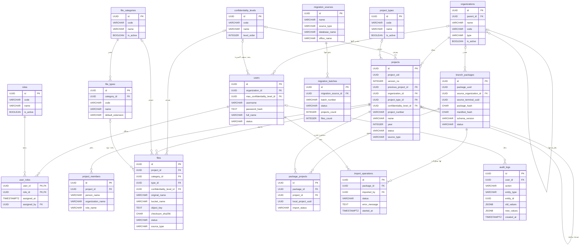

# المنصة المركزية - توصيف ERD

## النسخة العملية المبسطة للمرحلة الأولى - PostgreSQL + MinIO

إصدار مبسط للمرحلة الأولى (MVP)، منفصل عن الـ ERD الآخر، وجاهز ليكون مرجعًا للفريق أثناء التطوير.

> **مبدأ التصميم:** هذا التقرير لا يخلط بين قاعدة المنصة وقاعدة الطرفية. كل قاعدة لها مسؤولية وحدود واضحة، والربط بينهما يتم فقط عبر الحزمة المشفرة والـ Manifest.

## 1. نطاق هذا الـ ERD

هذا الـ ERD يخص المنصة المركزية فقط. قاعدة البيانات المقترحة PostgreSQL، والملفات الفيزيائية تحفظ في MinIO. المنصة المركزية هي مصدر الحقيقة النهائي، وتستقبل حزم الطرفية، وتراجع المشاريع وتدققها قبل الاعتماد. تم حذف OCR/AI والصلاحيات (Permissions) التفصيلية من المرحلة الأولى لتبسيط التنفيذ.

## 2. القرارات المعتمدة

1. PostgreSQL للبيانات الوصفية والعلاقات، وMinIO لتخزين الملفات الفيزيائية.
2. الصلاحيات في MVP: جداول `users` و`roles` و`user_roles` فقط، دون `permissions` تفصيلية.
3. الهيكل الإداري جدول شجري واحد هو `organizations`.
4. حالة المشروع حقل واحد هو `status`، دون جدول Workflow مستقل.
5. أي تعديل جوهري بعد التصدير أو الاعتماد ينتج Version جديدًا عبر `project_uid` و`version_no`.
6. المشروع المستورد من الطرفية لا يعتمد مباشرة، بل يدخل مرحلة المراجعة.
7. OCR مؤجل بالكامل، ولا يوجد له جدول في هذه النسخة.
8. الترحيل من النظام القديم موجود منذ المرحلة الأولى بجداول بسيطة.
9. سجل واحد `audit_logs` يكفي مبدئيًا، مع `old_values` و`new_values` اختياريين.

## 3. مخطط ERD

## 4. ملخص الجداول

| الجدول | المسؤولية | ملاحظات التنفيذ |
|---|---|---|
| `organizations` | يمثل الشجرة الإدارية في المركز: شركة، مصنع، خط، قسم. يرتبط المشروع بجهة واحدة من هذه الشجرة، وغالبًا تكون القسم أو المستوى التشغيلي الأدنى. | MVP |
| `users` | مستخدمو المنصة المركزية فقط. لا يمثل بالضرورة مستخدم الطرفية المحلي، لأن الطرفية تعمل كأداة إدخال مستقلة. | MVP |
| `roles` | تعريف الأدوار العامة للمنصة دون الدخول في نظام Permissions تفصيلي. | MVP |
| `user_roles` | ربط المستخدمين بأدوارهم. يسمح بأكثر من دور للمستخدم دون بناء نموذج صلاحيات كامل. | MVP |
| `project_types` | قاموس أنواع المشاريع في المركز. يوزع للطرفية كقائمة جاهزة للمرحلة الأولى. | MVP |
| `confidentiality_levels` | قاموس مستويات السرية. يستخدم على المشروع وعلى الملف، ويؤثر على البحث والعرض والتحميل. | MVP |
| `projects` | الكيان الأرشيفي الرئيسي. كل Version من المشروع يمثل سجلًا مستقلًا، وتجمع نسخه قيمة `project_uid` واحدة. | MVP |
| `project_members` | يمثل الكادر أو الجهات والأفراد المشاركين في المشروع، بصورة مرنة وغير مقيدة بأدوار ثابتة. | MVP |
| `file_categories` | التصنيف الرئيسي للملف، مثل: وثائق، تجارب، صور، فيديوهات، تقارير. في MVP لا تقترح الطرفية تصنيفات جديدة. | MVP |
| `file_types` | نوع فرعي داخل التصنيف؛ مثل PDF وWord وExcel داخل الوثائق، أو نتائج اختبار داخل التجارب. | MVP |
| `files` | بيانات الملفات في المركز. الملف الفيزيائي محفوظ في MinIO، والجدول يحفظ البيانات الوصفية ومفاتيح الوصول فقط. | MVP |
| `branch_packages` | يسجل الحزمة الواصلة من الطرفية. الحزمة نفسها ملف مشفر، أما قاعدة البيانات فتحفظ معلومات التحقق والتتبع فقط. | MVP |
| `package_projects` | يربط الحزمة بالمشاريع التي تم إنشاؤها أو مطابقتها داخل المركز. | MVP |
| `import_operations` | يسجل محاولة استيراد الحزمة كاملة، ويفصل الاستلام عن الاستيراد الفعلي. | MVP |
| `migration_sources` | يمثل مصادر الترحيل من قواعد النظام القديم، مثل قاعدة مكتب أو نسخة تشغيل قديمة. | MVP |
| `migration_batches` | يمثل دفعة ترحيل من مصدر محدد، مع عدد المشاريع والملفات وحالة التنفيذ. | MVP |
| `audit_logs` | سجل عمليات بسيط يغطي الحركة المهمة قدر الإمكان دون بناء نظام تدقيق معقد. | MVP |

## 5. توصيف الجداول والحقول

### `organizations`

يمثل الشجرة الإدارية في المركز: شركة، مصنع، خط، قسم. يرتبط المشروع بجهة واحدة من هذه الشجرة، وغالبًا تكون القسم أو المستوى التشغيلي الأدنى.

**قواعد مختصرة:** جدول شجري واحد بدل جداول منفصلة للمستويات؛ لا تحذف الجهات فعليًا، بل تعطل عند الحاجة.

| الحقل | النوع | الإلزام / القيد | الوصف |
|---|---|---|---|
| `id` | `UUID` | `PK, DEFAULT gen_random_uuid()` | المعرف الداخلي للجهة. |
| `parent_id` | `UUID` | `FK -> organizations.id, NULL` | الأب في الشجرة الإدارية. يكون `NULL` للشركة أو الجذر. |
| `name` | `VARCHAR(200)` | `NOT NULL` | اسم الجهة كما يظهر للمستخدمين. |
| `code` | `VARCHAR(60)` | `UNIQUE, NOT NULL` | كود مختصر مستقر للجهة، يستخدم في البحث والتصدير والتكامل. |
| `type` | `VARCHAR(30)` | `CHECK` | نوع المستوى: `COMPANY`, `FACTORY`, `LINE`, `DEPARTMENT`. |
| `description` | `TEXT` | `NULL` | وصف اختياري للجهة أو ملاحظات إدارية. |
| `is_active` | `BOOLEAN` | `DEFAULT true` | تعطيل الجهة بدل حذفها. |
| `created_at` | `TIMESTAMPTZ` | `DEFAULT now()` | وقت إنشاء السجل. |

### `users`

مستخدمو المنصة المركزية فقط. لا يمثل بالضرورة مستخدم الطرفية المحلي، لأن الطرفية تعمل كأداة إدخال مستقلة.

**قواعد مختصرة:** قد يمتلك المستخدم أكثر من دور عبر `user_roles`؛ يستخدم `max_confidentiality_level_id` كقيد بسيط للعرض والتحميل في MVP.

| الحقل | النوع | الإلزام / القيد | الوصف |
|---|---|---|---|
| `id` | `UUID` | `PK` | معرف المستخدم. |
| `username` | `VARCHAR(80)` | `UNIQUE, NOT NULL` | اسم الدخول. |
| `password_hash` | `TEXT` | `NOT NULL` | كلمة المرور مخزنة كـ Hash وليس كنص صريح. |
| `full_name` | `VARCHAR(200)` | `NOT NULL` | الاسم الكامل. |
| `email` | `VARCHAR(200)` | `UNIQUE, NULL` | البريد الإلكتروني إن وجد. |
| `organization_id` | `UUID` | `FK -> organizations.id, NULL` | الجهة التي يتبع لها المستخدم إداريًا. |
| `max_confidentiality_level_id` | `UUID` | `FK -> confidentiality_levels.id, NULL` | أعلى مستوى سرية مسموح للمستخدم رؤيته في المرحلة الأولى. |
| `status` | `VARCHAR(30)` | `CHECK` | إحدى القيم: `ACTIVE`, `DISABLED`, `LOCKED`. |
| `created_at` | `TIMESTAMPTZ` | `DEFAULT now()` | وقت الإنشاء. |
| `updated_at` | `TIMESTAMPTZ` | `NULL` | وقت آخر تعديل. |

### `roles`

تعريف الأدوار المركزية للمنصة دون الدخول في نظام Permissions تفصيلي.

**قواعد مختصرة:** لا يوجد `role_permissions` في MVP؛ صلاحيات الدور تطبق في الكود أو الخدمات مبدئيًا.

الأدوار المركزية المعتمدة فقط هي:
| الدور البرمجي | الاسم العربي | الوظيفة الأساسية |
|---|---|---|
| `system_admin` | مدير النظام | إدارة المستخدمين والأدوار والجهات والنظام والصلاحيات الحساسة |
| `central_data_entry` | مدخل بيانات مركزي | إنشاء المشاريع وتعديلها وإضافة الملفات من داخل المركز |
| `auditor` | مدقق | مراجعة المشاريع والملفات ثم الاعتماد أو طلب الاستكمال/الرفض |
| `archive_officer` | مسؤول أرشفة | تنفيذ وإدارة عمليات أرشفة المشاريع |
| `import_officer` | مسؤول استيراد | استيراد الحزم إلى النظام المركزي |
| `export_officer` | مسؤول تصدير | تصدير المشاريع والملفات والحزم |
| `read_only` | مستخدم قراءة فقط | استعراض البيانات المسموح بها بدون تعديل |

لا توجد أدوار خاصة بالفروع في التطبيق المركزي.

| الحقل | النوع | الإلزام / القيد | الوصف |
|---|---|---|---|
| `id` | `UUID` | `PK` | معرف الدور. |
| `code` | `VARCHAR(60)` | `UNIQUE, NOT NULL` | كود الدور، مثل: `system_admin`, `central_data_entry`, `auditor`, `archive_officer`, `import_officer`, `export_officer`, `read_only`. |
| `name` | `VARCHAR(120)` | `NOT NULL` | اسم الدور للعرض. |
| `description` | `TEXT` | `NULL` | وصف مختصر لصلاحية الدور. |
| `is_active` | `BOOLEAN` | `DEFAULT true` | إتاحة تعطيل الدور. |

### `user_roles`

ربط المستخدمين بأدوارهم. يسمح بأكثر من دور للمستخدم دون بناء نموذج صلاحيات كامل.

**قواعد مختصرة:** مفتاح أساسي مركب من `user_id` و`role_id`.

| الحقل | النوع | الإلزام / القيد | الوصف |
|---|---|---|---|
| `user_id` | `UUID` | `PK, FK -> users.id` | المستخدم. |
| `role_id` | `UUID` | `PK, FK -> roles.id` | الدور. |
| `assigned_at` | `TIMESTAMPTZ` | `DEFAULT now()` | وقت منح الدور. |
| `assigned_by` | `UUID` | `FK -> users.id, NULL` | من منح الدور إن وجد. |

### `project_types`

قاموس أنواع المشاريع في المركز. يوزع للطرفية كقائمة جاهزة للمرحلة الأولى.

| الحقل | النوع | الإلزام / القيد | الوصف |
|---|---|---|---|
| `id` | `UUID` | `PK` | معرف نوع المشروع. |
| `code` | `VARCHAR(60)` | `UNIQUE, NOT NULL` | كود النوع. |
| `name` | `VARCHAR(160)` | `NOT NULL` | اسم النوع. |
| `description` | `TEXT` | `NULL` | وصف اختياري. |
| `is_active` | `BOOLEAN` | `DEFAULT true` | إتاحة تعطيل النوع دون حذفه. |

### `confidentiality_levels`

قاموس مستويات السرية. يستخدم على المشروع وعلى الملف، ويؤثر على البحث والعرض والتحميل.

**قواعد مختصرة:** التحكم في السرية مبسط عبر `level_order`؛ لا تضاف جداول Clearance تفصيلية في MVP.

| الحقل | النوع | الإلزام / القيد | الوصف |
|---|---|---|---|
| `id` | `UUID` | `PK` | معرف مستوى السرية. |
| `code` | `VARCHAR(60)` | `UNIQUE, NOT NULL` | كود المستوى. |
| `name` | `VARCHAR(120)` | `NOT NULL` | اسم المستوى: عادي، داخلي، سري، سري جدًا. |
| `level_order` | `INTEGER` | `UNIQUE, NOT NULL` | ترتيب رقمي للمقارنة، مثل 1 إلى 4. |
| `description` | `TEXT` | `NULL` | وصف المستوى. |

### `projects`

الكيان الأرشيفي الرئيسي. كل Version من المشروع يمثل سجلًا مستقلًا، وتجمع نسخه قيمة `project_uid` واحدة.

**قواعد مختصرة:** لا يعدل المشروع المصدر أو المعتمد مباشرة؛ أي تعديل جوهري يصبح Version جديدًا. المشروع المستورد يدخل المراجعة ولا يصبح معتمدًا مباشرة. رقم المشروع ليس فريدًا عالميًا، بل ضمن الجهة والسنة والنسخة.

| الحقل | النوع | الإلزام / القيد | الوصف |
|---|---|---|---|
| `id` | `UUID` | `PK` | معرف سجل النسخة الحالية من المشروع. |
| `project_uid` | `UUID` | `NOT NULL` | معرف ثابت يجمع كل نسخ المشروع الواحد. |
| `version_no` | `INTEGER` | `NOT NULL, CHECK >= 1` | رقم النسخة؛ النسخة الأولى 1، ثم 2 وهكذا. |
| `previous_project_id` | `UUID` | `FK -> projects.id, NULL` | النسخة السابقة من المشروع إن وجدت. |
| `is_latest_version` | `BOOLEAN` | `DEFAULT true` | هل هذه أحدث نسخة مدخلة لنفس `project_uid`. |
| `organization_id` | `UUID` | `FK -> organizations.id` | الجهة أو القسم الذي يتبع له المشروع. |
| `project_type_id` | `UUID` | `FK -> project_types.id, NULL` | نوع المشروع. |
| `confidentiality_level_id` | `UUID` | `FK -> confidentiality_levels.id, NULL` | مستوى السرية العام للمشروع. |
| `project_number` | `VARCHAR(80)` | `NOT NULL` | رقم المشروع كما هو معتمد إداريًا. |
| `project_code` | `VARCHAR(100)` | `NULL` | كود إضافي إن وجد. |
| `name` | `VARCHAR(250)` | `NOT NULL` | اسم المشروع. |
| `year` | `INTEGER` | `NOT NULL` | سنة المشروع. |
| `executing_entity` | `VARCHAR(200)` | `NULL` | الجهة المنفذة إن وجدت. |
| `supervisor_name` | `VARCHAR(200)` | `NULL` | اسم المشرف كحقل سريع، مع إمكانية إضافة كادر كامل في `project_members`. |
| `description` | `TEXT` | `NULL` | تفاصيل المشروع. |
| `notes` | `TEXT` | `NULL` | ملاحظات عامة. |
| `table_of_contents` | `TEXT` | `NULL` | جدول محتويات نصي حر في MVP. |
| `keywords` | `TEXT` | `NULL` | كلمات مفتاحية للبحث. |
| `status` | `VARCHAR(40)` | `CHECK` | إحدى القيم: `DRAFT`, `IMPORTED`, `UNDER_REVIEW`, `NEEDS_CORRECTION`, `APPROVED`, `ARCHIVED`. |
| `data_completion_status` | `VARCHAR(40)` | `NULL` | `COMPLETE`, `INCOMPLETE`، أو `NULL` حسب الحاجة. |
| `review_notes` | `TEXT` | `NULL` | ملاحظات المدقق أو سبب طلب التصحيح. |
| `source_type` | `VARCHAR(40)` | `CHECK` | إحدى القيم: `MANUAL`, `BRANCH_PACKAGE`, `MIGRATION`. |
| `source_reference` | `TEXT` | `NULL` | مرجع المصدر: رقم حزمة، اسم قاعدة قديمة، أو ملاحظة. |
| `created_by` | `UUID` | `FK -> users.id, NULL` | من أنشأ السجل في المركز. |
| `approved_by` | `UUID` | `FK -> users.id, NULL` | من اعتمد النسخة، إن اعتمدت. |
| `approved_at` | `TIMESTAMPTZ` | `NULL` | وقت الاعتماد. |
| `created_at` | `TIMESTAMPTZ` | `DEFAULT now()` | وقت إنشاء النسخة. |
| `updated_at` | `TIMESTAMPTZ` | `NULL` | وقت آخر تعديل. |

### `project_members`

يمثل الكادر أو الجهات والأفراد المشاركين في المشروع، بصورة مرنة وغير مقيدة بأدوار ثابتة.

| الحقل | النوع | الإلزام / القيد | الوصف |
|---|---|---|---|
| `id` | `UUID` | `PK` | معرف السجل. |
| `project_id` | `UUID` | `FK -> projects.id` | نسخة المشروع التي ينتمي إليها العضو. |
| `person_name` | `VARCHAR(200)` | `NOT NULL` | اسم الشخص أو الجهة. |
| `organization_name` | `VARCHAR(200)` | `NULL` | اسم الجهة أو الشركة إن وجد. |
| `role_name` | `VARCHAR(120)` | `NULL` | الدور داخل المشروع: مشرف، منفذ، مدقق، مشارك، وغيرها. |
| `notes` | `TEXT` | `NULL` | ملاحظات. |

### `file_categories`

التصنيف الرئيسي للملف، مثل: وثائق، تجارب، صور، فيديوهات، تقارير. في MVP لا تقترح الطرفية تصنيفات جديدة.

| الحقل | النوع | الإلزام / القيد | الوصف |
|---|---|---|---|
| `id` | `UUID` | `PK` | معرف التصنيف. |
| `code` | `VARCHAR(60)` | `UNIQUE, NOT NULL` | كود التصنيف. |
| `name` | `VARCHAR(160)` | `NOT NULL` | اسم التصنيف. |
| `description` | `TEXT` | `NULL` | وصف اختياري. |
| `is_active` | `BOOLEAN` | `DEFAULT true` | تعطيل التصنيف دون حذفه. |

### `file_types`

نوع فرعي داخل التصنيف. مثال: PDF وWord وExcel داخل الوثائق، أو نتائج اختبار داخل التجارب.

| الحقل | النوع | الإلزام / القيد | الوصف |
|---|---|---|---|
| `id` | `UUID` | `PK` | معرف النوع. |
| `category_id` | `UUID` | `FK -> file_categories.id` | التصنيف الذي يتبعه النوع. |
| `code` | `VARCHAR(60)` | `UNIQUE, NOT NULL` | كود النوع. |
| `name` | `VARCHAR(160)` | `NOT NULL` | اسم النوع. |
| `default_extension` | `VARCHAR(20)` | `NULL` | امتداد افتراضي، مثل `pdf` أو `docx`، إن وجد. |
| `description` | `TEXT` | `NULL` | وصف اختياري. |
| `is_active` | `BOOLEAN` | `DEFAULT true` | تعطيل النوع دون حذفه. |

### `files`

بيانات الملفات في المركز. الملف الفيزيائي محفوظ في MinIO، والجدول يحفظ البيانات الوصفية ومفاتيح الوصول فقط.

**قواعد مختصرة:** لا تخزن BLOB داخل PostgreSQL؛ الحذف منطقي فقط ولا يحذف الملف من MinIO؛ كل ملف يتبع نسخة مشروع محددة.

| الحقل | النوع | الإلزام / القيد | الوصف |
|---|---|---|---|
| `id` | `UUID` | `PK` | معرف الملف. |
| `project_id` | `UUID` | `FK -> projects.id` | نسخة المشروع التي ينتمي إليها الملف. |
| `category_id` | `UUID` | `FK -> file_categories.id, NULL` | تصنيف الملف. |
| `type_id` | `UUID` | `FK -> file_types.id, NULL` | نوع الملف الفرعي. |
| `confidentiality_level_id` | `UUID` | `FK -> confidentiality_levels.id, NULL` | مستوى سرية الملف. |
| `original_name` | `VARCHAR(300)` | `NOT NULL` | اسم الملف الأصلي كما رفعه المستخدم. |
| `stored_name` | `VARCHAR(300)` | `NOT NULL` | اسم التخزين الداخلي أو الاسم المولد. |
| `bucket_name` | `VARCHAR(120)` | `NOT NULL` | اسم Bucket في MinIO. |
| `object_key` | `TEXT` | `NOT NULL` | المسار أو المفتاح داخل MinIO. |
| `extension` | `VARCHAR(20)` | `NULL` | امتداد الملف. |
| `mime_type` | `VARCHAR(150)` | `NULL` | نوع MIME. |
| `size_bytes` | `BIGINT` | `NULL` | حجم الملف بالبايت. |
| `checksum_sha256` | `CHAR(64)` | `INDEX, NULL` | Hash للتحقق من سلامة المحتوى ومنع التكرار قدر الإمكان. |
| `status` | `VARCHAR(40)` | `CHECK` | إحدى القيم: `ACTIVE`, `DELETED`, `REPLACED`. |
| `uploaded_by` | `UUID` | `FK -> users.id, NULL` | من رفع الملف أو أدخله في المركز. |
| `source_type` | `VARCHAR(40)` | `CHECK` | إحدى القيم: `MANUAL`, `BRANCH_PACKAGE`, `MIGRATION`. |
| `source_reference` | `TEXT` | `NULL` | مرجع مصدر الملف. |
| `deleted_at` | `TIMESTAMPTZ` | `NULL` | وقت الحذف المنطقي. |
| `deleted_by` | `UUID` | `FK -> users.id, NULL` | من حذف الملف منطقيًا. |
| `delete_reason` | `TEXT` | `NULL` | سبب الحذف عند الحاجة. |
| `created_at` | `TIMESTAMPTZ` | `DEFAULT now()` | وقت إضافة السجل. |

### `branch_packages`

يسجل الحزمة الواصلة من الطرفية. الحزمة نفسها ملف مشفر، أما قاعدة البيانات فتحفظ معلومات التحقق والتتبع فقط.

**قواعد مختصرة:** قد تحتوي الحزمة عدة مشاريع؛ لا تخزن مفاتيح التشفير في قاعدة البيانات؛ يستخدم `package_uuid` و`package_hash` لمنع التكرار.

| الحقل | النوع | الإلزام / القيد | الوصف |
|---|---|---|---|
| `id` | `UUID` | `PK` | معرف السجل في المركز. |
| `package_uuid` | `UUID` | `UNIQUE, NOT NULL` | معرف فريد مولد في الطرفية للحزمة. |
| `source_organization_id` | `UUID` | `FK -> organizations.id, NULL` | الجهة المصدرة للحزمة بعد ربطها بشجرة المركز. |
| `source_terminal_uuid` | `UUID` | `NOT NULL` | معرف نسخة الطرفية التي أنشأت الحزمة. |
| `source_username` | `VARCHAR(120)` | `NULL` | اسم المستخدم المحلي الذي أنشأ الحزمة. |
| `package_name` | `VARCHAR(300)` | `NOT NULL` | اسم ملف الحزمة. |
| `package_hash` | `CHAR(64)` | `UNIQUE, NOT NULL` | Hash كامل للحزمة المشفرة. |
| `manifest_hash` | `CHAR(64)` | `NOT NULL` | Hash للـ Manifest بعد استخراجه والتحقق منه. |
| `schema_version` | `VARCHAR(30)` | `NOT NULL` | إصدار عقد الحزمة أو الـ Manifest. |
| `projects_count` | `INTEGER` | `DEFAULT 0` | عدد المشاريع داخل الحزمة. |
| `files_count` | `INTEGER` | `DEFAULT 0` | عدد الملفات داخل الحزمة. |
| `status` | `VARCHAR(40)` | `CHECK` | إحدى القيم: `RECEIVED`, `VERIFIED`, `IMPORTED`, `FAILED`, `DUPLICATE`. |
| `received_by` | `UUID` | `FK -> users.id, NULL` | المستخدم المركزي الذي استقبل الحزمة. |
| `received_at` | `TIMESTAMPTZ` | `DEFAULT now()` | وقت الاستلام. |

### `package_projects`

يربط الحزمة بالمشاريع التي تم إنشاؤها أو مطابقتها داخل المركز.

| الحقل | النوع | الإلزام / القيد | الوصف |
|---|---|---|---|
| `id` | `UUID` | `PK` | معرف الربط. |
| `package_id` | `UUID` | `FK -> branch_packages.id` | الحزمة. |
| `project_id` | `UUID` | `FK -> projects.id` | نسخة المشروع المنشأة في المركز. |
| `local_project_uuid` | `UUID` | `NOT NULL` | معرف المشروع داخل الطرفية. |
| `import_status` | `VARCHAR(40)` | `CHECK` | إحدى القيم: `IMPORTED`, `SKIPPED`, `FAILED`, `DUPLICATE`. |

### `import_operations`

يسجل محاولة استيراد الحزمة كاملة، ويستخدم لفصل الاستلام عن الاستيراد الفعلي.

| الحقل | النوع | الإلزام / القيد | الوصف |
|---|---|---|---|
| `id` | `UUID` | `PK` | معرف العملية. |
| `package_id` | `UUID` | `FK -> branch_packages.id` | الحزمة المستوردة. |
| `imported_by` | `UUID` | `FK -> users.id` | المستخدم الذي نفذ الاستيراد. |
| `status` | `VARCHAR(40)` | `CHECK` | إحدى القيم: `STARTED`, `SUCCESS`, `FAILED`, `PARTIAL`. |
| `error_message` | `TEXT` | `NULL` | رسالة الخطأ العامة إن فشل الاستيراد. |
| `started_at` | `TIMESTAMPTZ` | `DEFAULT now()` | وقت بداية العملية. |
| `completed_at` | `TIMESTAMPTZ` | `NULL` | وقت النهاية. |

### `migration_sources`

يمثل مصادر الترحيل من قواعد النظام القديم، مثل قاعدة مكتب أو نسخة تشغيل قديمة.

| الحقل | النوع | الإلزام / القيد | الوصف |
|---|---|---|---|
| `id` | `UUID` | `PK` | معرف المصدر. |
| `name` | `VARCHAR(200)` | `NOT NULL` | اسم واضح للمصدر. |
| `source_type` | `VARCHAR(60)` | `NULL` | نوع المصدر: PostgreSQL قديم، ملف، نسخة مكتب، وغيرها. |
| `database_name` | `VARCHAR(200)` | `NULL` | اسم قاعدة البيانات القديمة إن وجد. |
| `office_name` | `VARCHAR(200)` | `NULL` | المكتب أو الجهة المرتبطة بالمصدر. |
| `description` | `TEXT` | `NULL` | ملاحظات حول المصدر. |
| `created_at` | `TIMESTAMPTZ` | `DEFAULT now()` | وقت تعريف المصدر. |

### `migration_batches`

يمثل دفعة ترحيل من مصدر محدد، مع عدد المشاريع والملفات وحالة التنفيذ.

| الحقل | النوع | الإلزام / القيد | الوصف |
|---|---|---|---|
| `id` | `UUID` | `PK` | معرف الدفعة. |
| `migration_source_id` | `UUID` | `FK -> migration_sources.id` | المصدر القديم. |
| `batch_number` | `VARCHAR(80)` | `NOT NULL` | رقم أو اسم الدفعة. |
| `started_at` | `TIMESTAMPTZ` | `NULL` | بداية الترحيل. |
| `completed_at` | `TIMESTAMPTZ` | `NULL` | نهاية الترحيل. |
| `status` | `VARCHAR(40)` | `CHECK` | إحدى القيم: `PLANNED`, `RUNNING`, `SUCCESS`, `FAILED`, `PARTIAL`. |
| `projects_count` | `INTEGER` | `DEFAULT 0` | عدد المشاريع المرحلة. |
| `files_count` | `INTEGER` | `DEFAULT 0` | عدد الملفات المرحلة. |
| `notes` | `TEXT` | `NULL` | ملاحظات الترحيل. |

### `audit_logs`

سجل عمليات بسيط يغطي الحركة المهمة قدر الإمكان دون بناء نظام تدقيق معقد.

**قواعد مختصرة:** القيم القديمة والجديدة اختيارية وتخزن بصيغة JSONB عند الحاجة؛ لا يغني السجل عن النسخ الاحتياطي ولا عن سياسات التطبيق.

| الحقل | النوع | الإلزام / القيد | الوصف |
|---|---|---|---|
| `id` | `UUID` | `PK` | معرف السجل. |
| `user_id` | `UUID` | `FK -> users.id, NULL` | المستخدم المنفذ إن كان معروفًا. |
| `action` | `VARCHAR(100)` | `NOT NULL` | اسم العملية، مثل: `LOGIN`, `CREATE_PROJECT`, `IMPORT_PACKAGE`. |
| `entity_type` | `VARCHAR(100)` | `NULL` | نوع الكيان المتأثر. |
| `entity_id` | `UUID` | `NULL` | معرف الكيان المتأثر. |
| `description` | `TEXT` | `NULL` | وصف مختصر للحركة. |
| `old_values` | `JSONB` | `NULL` | القيم القديمة عند الحاجة. |
| `new_values` | `JSONB` | `NULL` | القيم الجديدة عند الحاجة. |
| `ip_address` | `INET` | `NULL` | عنوان الجهاز أو المصدر إن توفر. |
| `created_at` | `TIMESTAMPTZ` | `DEFAULT now()` | وقت العملية. |

## 6. العلاقات الأساسية

| من | إلى | العلاقة | المعنى العملي |
|---|---|---|---|
| `organizations.parent_id` | `organizations.id` | N:1 ذاتية | بناء الشجرة الإدارية: شركة ← مصنع ← خط ← قسم. |
| `users.organization_id` | `organizations.id` | N:1 | ربط المستخدم المركزي بجهته الإدارية. |
| `user_roles.user_id` | `users.id` | N:1 | المستخدم قد يمتلك أكثر من دور. |
| `user_roles.role_id` | `roles.id` | N:1 | الدور يمكن منحه لعدة مستخدمين. |
| `projects.organization_id` | `organizations.id` | N:1 | كل نسخة مشروع تتبع جهة واحدة. |
| `projects.project_type_id` | `project_types.id` | N:1 | نوع المشروع من قاموس مركزي. |
| `projects.confidentiality_level_id` | `confidentiality_levels.id` | N:1 | مستوى سرية عام للمشروع. |
| `projects.previous_project_id` | `projects.id` | N:1 ذاتية | كل نسخة يمكن أن تشير إلى النسخة السابقة. |
| `project_members.project_id` | `projects.id` | N:1 | كل نسخة مشروع لها كادرها. |
| `file_types.category_id` | `file_categories.id` | N:1 | كل نوع ملف ينتمي لتصنيف واحد. |
| `files.project_id` | `projects.id` | N:1 | كل ملف يتبع نسخة مشروع محددة. |
| `files.category_id` | `file_categories.id` | N:1 | تصنيف الملف. |
| `files.type_id` | `file_types.id` | N:1 | النوع الفرعي للملف. |
| `branch_packages.source_organization_id` | `organizations.id` | N:1 | الجهة المصدرة للحزمة بعد ربطها بالمركز. |
| `package_projects.package_id` | `branch_packages.id` | N:1 | الحزمة الواحدة قد تحتوي عدة مشاريع. |
| `package_projects.project_id` | `projects.id` | N:1 | كل مشروع مستورد يسجل داخل الحزمة التي جاء منها. |
| `import_operations.package_id` | `branch_packages.id` | N:1 | كل محاولة استيراد ترتبط بحزمة. |
| `migration_batches.migration_source_id` | `migration_sources.id` | N:1 | كل دفعة ترحيل تأتي من مصدر قديم. |
| `audit_logs.user_id` | `users.id` | N:1 | ربط الحركة بالمستخدم المنفذ إن وجد. |

## 7. القيود والفهارس المقترحة

- `UNIQUE(project_uid, version_no)` لضمان عدم تكرار النسخة نفسها من المشروع.
- `UNIQUE(organization_id, project_number, year, version_no)` لأن رقم المشروع قد يتكرر بين جهات مختلفة.
- Index على `projects(status)` لتسريع قوائم المراجعة والاعتماد.
- Index على `projects(project_uid, is_latest_version)` للوصول إلى أحدث نسخة بسرعة.
- Index على `files(project_id)` و`files(checksum_sha256)` للبحث والتحقق.
- `UNIQUE` على `branch_packages.package_uuid` و`branch_packages.package_hash` لمنع إعادة استيراد الحزمة نفسها.
- Index على `audit_logs(entity_type, entity_id)` لتتبع عمليات كيان محدد.

## 8. تدفق العمل المختصر

1. يدخل المستخدم المركزي مشروعًا يدويًا، أو يستورد حزمة من الطرفية، أو يرحل بيانات من النظام القديم.
2. تفحص الحزمة عبر `package_uuid` و`package_hash` و`manifest_hash` قبل الاستيراد.
3. تدخل المشاريع المستوردة بالحالة `status = IMPORTED`، ولا تعتمد مباشرة.
4. يراجع المدقق الجهة، والبيانات الوصفية، والكادر، والملفات، والتصنيف، والسرية.
5. عند الاعتماد تصبح الحالة `APPROVED` أو `ARCHIVED` حسب قرار العمل.
6. أي تعديل جوهري لاحق ينتج Version جديدًا بدل تعديل النسخة القديمة مباشرة.
7. تسجل كل حركة مهمة في `audit_logs` قدر الإمكان.

## 9. ما هو خارج نطاق هذه النسخة

- OCR والذكاء الاصطناعي مؤجلان بالكامل.
- نظام `permissions` التفصيلي مؤجل.
- اقتراح التصنيفات من الطرفية مؤجل.
- جداول تاريخ Workflow التفصيلية مؤجلة.
- فصل `file_objects` ونسخ الملفات الفيزيائية مؤجل.

> **ملاحظة ختامية:** هذا التصميم مقصود أن يكون عمليًا وقابلًا للتنفيذ من الفريق الحالي. يمكن توسيعه لاحقًا دون كسر الأساس، خصوصًا في OCR وملفات النسخ وPermissions.
